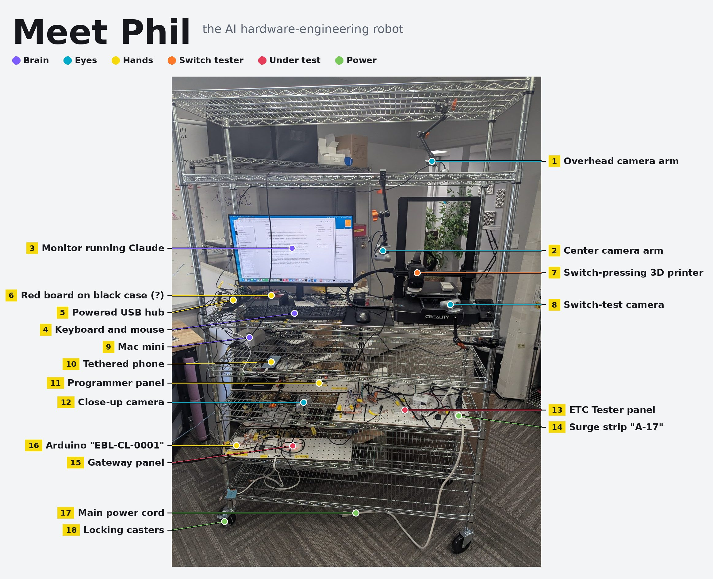
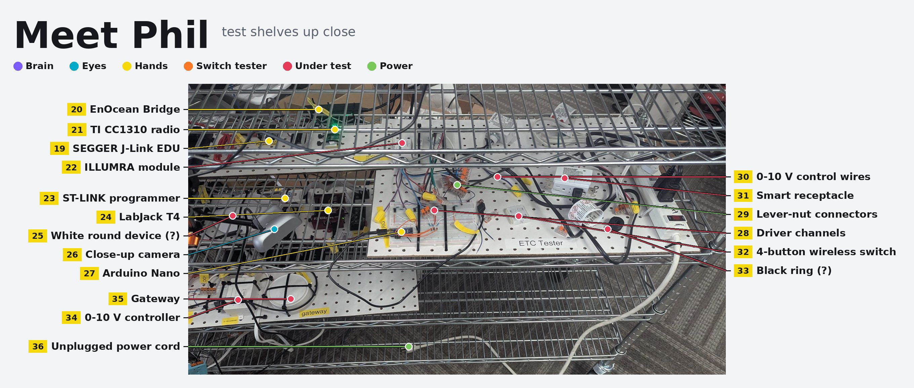
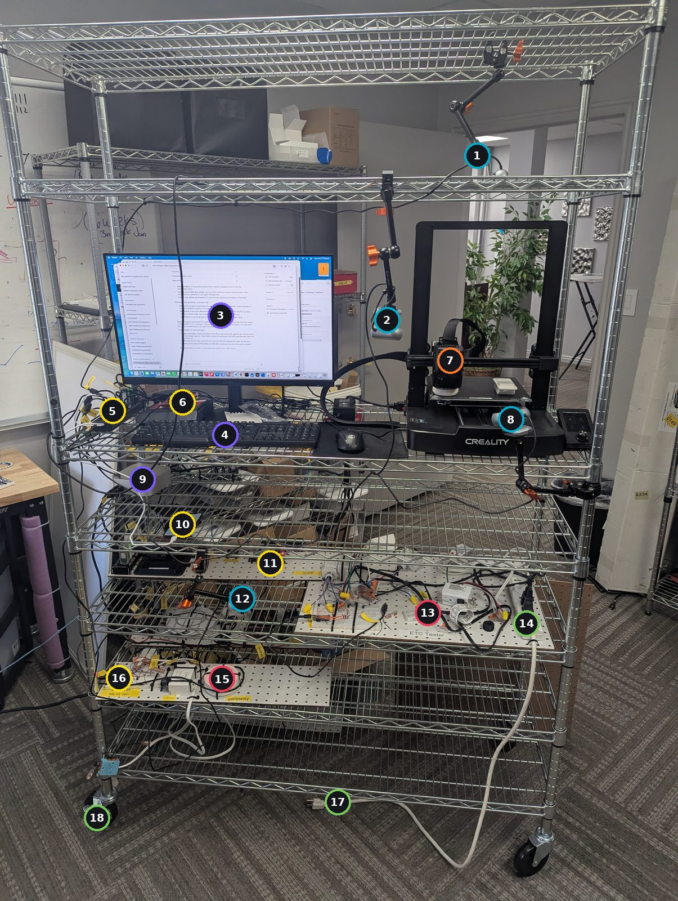
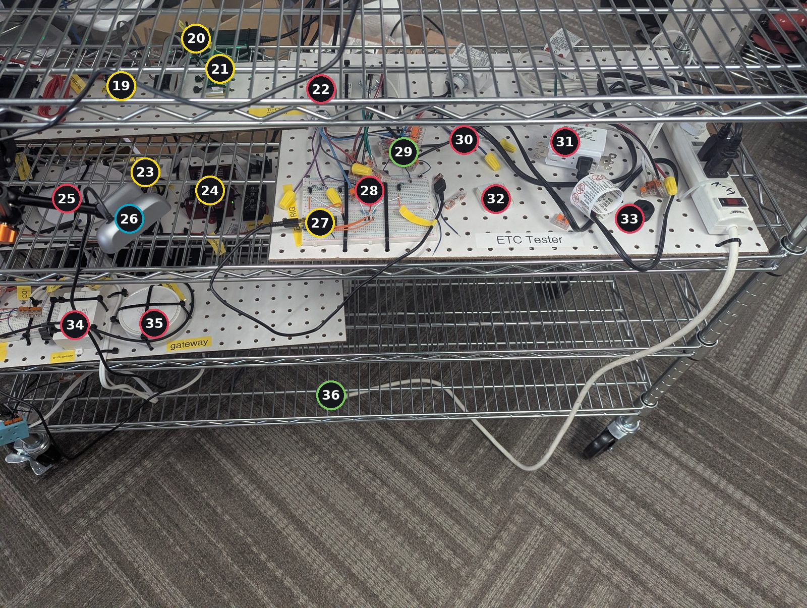

# Phil: the hardware-engineering robot

Phil is an AI agent with a body: a rolling wire cart that holds a computer
running Claude, cameras so it can see, and programmers, radios and I/O boards
so it can flash, probe and switch real hardware on its own. These photos are
labeled so anyone can tell what each part is and what it does for Phil.

Open `index.html` for the interactive version (tap a number to see what it is).

## How Phil is organized

| Role | What it does |
| --- | --- |
| **Brain** | Computer and AI agent that plans the work and drives everything else. |
| **Eyes** | Cameras so Phil can see LEDs, switch presses and wiring without a person looking. |
| **Hands** | Programmers, radios and I/O boards Phil uses to flash, probe and switch hardware. |
| **Switch tester** | A 3D printer used as a robot finger: it moves to a light switch and presses it, over and over, to test it. |
| **Under test** | Test fixtures and the lighting-control devices being tested. |
| **Power** | Mains power, wiring and the cart itself. |

## The whole cart

Front view of Phil, top shelf to casters.

### Top shelf and camera arms

| # | Part | Role | What it is |
| --- | --- | --- | --- |
| 1 | Overhead camera arm | Eyes | Articulating "magic arm" (orange locking knobs) clamped to the top shelf, holding small USB cameras that look down over the desk and the switch-testing printer. |
| 2 | Center camera arm | Eyes | Second magic arm hanging from the shelf with two webcams. Gives Phil a view of the work surface and the switch on the printer bed. |

### Desk shelf

| # | Part | Role | What it is |
| --- | --- | --- | --- |
| 3 | Monitor running Claude | Brain | Acer monitor showing the Claude desktop app on macOS. The open sessions are Phil's projects (EnOcean 902 MHz module, CC1310 sniffer, BLE switch OTA from phone, LabJack status, unattended-loop runs). |
| 4 | Keyboard and mouse | Brain | For people to step in. Day to day, Phil works through the computer without them. |
| 5 | Powered USB hub | Hands | Multi-port hub with yellow-tagged cables. Fans the computer out to the programmers, cameras and boards on the shelves below. |
| 6 | Red board on black case *(confirm)* | Hands | A red development board sitting on a black enclosure, connected by USB. Not labeled in the photo; confirm what it is. |
| 7 | Switch-pressing 3D printer | Switch tester | Creality 3D printer (looks like an Ender-3 V3 series) used only to test light switches. Phil moves the print head onto the switch mounted on the bed to press it, the same way every time. |
| 8 | Switch-test camera | Eyes | Webcam on a short arm aimed at the printer bed so Phil can watch each switch press and see the result. |

### Computer shelf

| # | Part | Role | What it is |
| --- | --- | --- | --- |
| 9 | Mac mini | Brain | Phil's computer. Runs Claude Code and every tool that talks to the hardware. |
| 10 | Tethered phone | Hands | Smartphone plugged in over USB, used to test phone apps such as BLE switch updates sent from a phone. |

### Test shelves

| # | Part | Role | What it is |
| --- | --- | --- | --- |
| 11 | Programmer panel | Hands | Pegboard with the debug programmers and radio tools. See the close-up photo, items 19 to 24. |
| 12 | Close-up camera | Eyes | Webcam on a magic arm pointed at the boards so Phil can read LEDs and check status. |
| 13 | ETC Tester panel | Under test | Pegboard test fixture: an Arduino-driven breadboard wired to mains and 0-10 V lighting circuits. See the close-up, items 27 to 33. |
| 14 | Surge strip "A-17" | Power | Prime surge-protected power strip with a lighted switch. Feeds the test panels. |
| 15 | Gateway panel | Under test | Bottom pegboard with a wireless lighting gateway (red ring light), a 0-10 V controller and a breadboard. |
| 16 | Arduino "EBL-CL-0001" | Hands | Small red Arduino-style board on a breadboard, labeled arduino EBL-CL-0001. Switches or simulates inputs for the gateway panel. |

### Bottom of the cart

| # | Part | Role | What it is |
| --- | --- | --- | --- |
| 17 | Main power cord | Power | White cord that powers the whole cart. In these photos the plug is lying on the floor, not in the wall. |
| 18 | Locking casters | Power | Chrome wire shelving rack on locking wheels, so Phil can be rolled to wherever the work is. |

## Test shelves up close

Looking down at the programmer panel, the ETC Tester and the gateway panel.

### Programmer panel (back)

| # | Part | Role | What it is |
| --- | --- | --- | --- |
| 19 | SEGGER J-Link EDU | Hands | Labeled "J-Link-EDU Programmer". Debug probe for flashing and debugging ARM microcontrollers. |
| 20 | EnOcean Bridge | Hands | Black USB device labeled "EnOcean Bridge". Lets the computer send and receive EnOcean wireless telegrams. |
| 21 | TI CC1310 radio | Hands | Small board with a green LED, labeled TI CC1310. Sub-GHz radio used as a sniffer to capture 902 MHz traffic. |
| 22 | ILLUMRA module | Under test | White ILLUMRA lighting-control module (an EnOcean-based product line) wired into the test circuits. |

### Programmer panel (front)

| # | Part | Role | What it is |
| --- | --- | --- | --- |
| 23 | ST-LINK programmer | Hands | White stick with the ST logo and a red LED. Programs and debugs STM32 microcontrollers. |
| 24 | LabJack T4 | Hands | Red USB data-acquisition box. Gives Phil analog and digital I/O to measure voltages and toggle signals. |
| 25 | White round device *(confirm)* | Under test | Round white puck under the camera, similar in style to the gateway. Confirm whether it is a sensor or a second gateway. |
| 26 | Close-up camera | Eyes | Same camera as item 12, on its magic arm with an orange clamp knob. |

### ETC Tester panel

| # | Part | Role | What it is |
| --- | --- | --- | --- |
| 27 | Arduino Nano | Hands | Blue Arduino Nano connected to the Mac by USB. The tester's controller: Phil sends it commands and it drives the channels next to it. |
| 28 | Driver channels | Under test | Breadboard with four small three-pin parts and resistors, likely transistor or optocoupler stages that let the Nano switch the circuits under test. |
| 29 | Lever-nut connectors | Power | Orange WAGO-style lever connectors and yellow wire nuts join the panel's wires without soldering, so Phil can rewire quickly. |
| 30 | 0-10 V control wires | Under test | Purple and gray pair printed "CONTROL 0-10V". The standard dimming signal used by commercial lighting. |
| 31 | Smart receptacle | Under test | White outlet with an FCC ID label and screw terminals: a connected (wireless) receptacle being tested. A cord is plugged in as its load. |
| 32 | 4-button wireless switch | Under test | Small white module with four button pads. Looks like an EnOcean PTM-style self-powered switch used as a wireless sender. |
| 33 | Black ring *(confirm)* | Under test | Round black core next to the wiring. Likely a ferrite or current-sense ring; confirm. |

### Gateway panel and floor

| # | Part | Role | What it is |
| --- | --- | --- | --- |
| 34 | 0-10 V controller | Under test | White box labeled "0-10v controller". Turns wireless commands into a 0-10 V dimming signal. |
| 35 | Gateway | Under test | Round white wireless lighting gateway held down with cable ties. It shows a red ring light when powered. |
| 36 | Unplugged power cord | Power | The end of the main power cord (item 17) lying on the floor. |

## Updating the labels

Items marked *(confirm)* were identified from the photo only. Edit
`labels.json` (x/y are pixel positions in the photo size listed there)
and run `python3 phil/build.py` to regenerate the labeled images,
this README and `index.html`.
